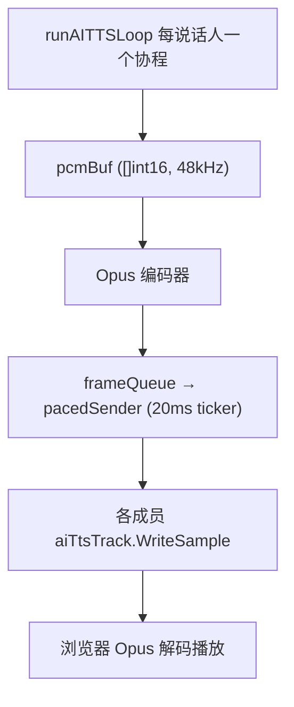

# WASM Opus 编码器内存损坏：随机崩溃排查与根治

> **日期**：2026-09-21
> **状态**：✅ 已解决 — 移除 `jj11hh/opus` WASM 桥，本地开发与部署统一改用 CGo 原生 libopus
> **关联追踪**：[investigation-log.md](investigation-log.md)
> **相关提交**：`5938a7a fix(sfu): 移除 WASM opus 编码器`

---

## 一、问题概述

### 1.1 现象

本地 Windows 环境用 `go run .` 启动后端，两个浏览器进同一房间对话、AI 语音助手回复时，后端**在完全随机的协程里周期性 panic**，进程崩溃退出。panic 位置与调用栈每次不同，与崩溃点所在业务无任何关系。

**崩溃 #1**：Opus 编码器内部空指针

```
panic: runtime error: invalid memory address or nil pointer dereference
[signal 0xc0000005 code=0x0 addr=0x0]
goroutine 581 [running]:
github.com/jj11hh/opus.(*Encoder).Encode(...)
        .../opus@v1.0.1/encoder.go:193
echat-backend/sfu.(*opusEncoder).Encode(...)
        backend/sfu/audio_encoder.go:28
echat-backend/sfu.(*SFURoom).runAITTSLoop(...)   // TTS 音频处理循环
        backend/sfu/sfu.go:856
```

**崩溃 #2**：TLS 建连时读取到野指针（损坏的 interface）

```
unexpected fault address 0x10b76c4770
fatal error: fault
[signal 0xc0000005 code=0x0 addr=0x10b76c4770]
goroutine 409 [running]:
context.(*timerCtx).Done(...)
        <autogenerated>:1
context.(*cancelCtx).propagateCancel(0x..., {0x..., 0x10b76c4770}, ...)
        src/context/context.go:478
crypto/tls.(*Conn).handshakeContext(...)
github.com/gorilla/websocket.(*Dialer).DialContext(...)   // 连接讯飞 TTS WebSocket
echat-backend/tts_cli.(*XfyunSynthesizer).synthesizeSentence(...)
        backend/tts_cli/xfyun_synthesizer.go:289
```

崩溃 #2 的关键点：`propagateCancel` 收到的父 context（即 `SessionPipeline.ctx`）接口值里，**数据指针是野地址 `0x10b76c4770`**。这个 `sp.ctx` 在 `CreateSession` 里只被赋值一次、之后只读，本身不可能变成野指针——说明有别的代码把**任意无关结构体**的内存写坏了。

### 1.2 影响范围

| 场景 | 状态 |
|------|------|
| 生产者/部署（Docker 镜像，`-tags opus_native`） | ✅ 正常，从未复现 |
| 本地 Windows 原生 `go run` / `go build`（无构建标签） | ❌ 随机 panic，多个无关协程 |
| 真人麦克风通话（非 TTS 路径） | ✅ 正常 |
| AI 语音回复（TTS 路径） | ❌ 高频触发崩溃 |

### 1.3 问题定性

**一句话根因：`jj11hh/opus` 是一个手搓的 C++→WASM libopus 桥，在 wazero 编译器引擎（amd64 默认 JIT）下执行时，发生了越界写穿 WASM 线性内存、砸进宿主 Go 堆内存的缺陷，导致整个进程任意位置随机崩溃。这不是 Go 代码竞态，而是底层 JIT 执行器层面的宿主内存损坏。**

---

## 二、系统背景：本地为什么会出现「两套编码器」

### 2.1 数据流



### 2.2 双路径来源

仓库里同时存在两个 Opus 编码器实现，用构建标签区分：

| 文件 | 构建标签 | 说明 |
|------|----------|------|
| `backend/sfu/audio_encoder_cgo.go` | `//go:build opus_native` | CGo 链接系统 libopus，生产级 |
| `backend/sfu/audio_encoder.go` | `//go:build !opus_native` | `jj11hh/opus` WASM 桥 |

- `backend/Dockerfile` 从构建起就传 `-tags opus_native` → **部署一直用 CGo 原生 libopus，从未崩溃**
- 本地 Windows 直接 `go run`（不带标签）→ 编译进 WASM 桥 → 崩溃

WASM 桥是当初在修「LLM 回复听不清」时引入的（见 [tts-audio-truncation](../tts-audio-truncation/case-study.md) 的 #8 尝试，理由是不想在 Windows 上装 libopus / 走 CGo）。它是为了「语音清晰度」替换 ccgo 转译版的实验性产物。

### 2.3 `jj11hh/opus` 的运行时架构

从模块源码 `wasm_context.go` 可见其设计：

- 进程内**唯一一个** wazero runtime + **唯一一份** WASM 线性内存（`sync.Once` + 全局 `globalWasmContext` 初始化）
- 所有编码器/解码器在**同一份线性内存**上 malloc/free，共用同一 C 堆
- **库内没有任何同步原语**：`Malloc.Call` / `Free.Call` / `opus_encode` 全程裸调，并发调用即踩踏共享堆
- 每个 `Encoder` 注册了 GC finalizer，不经任何锁直接对共享模块调 `Free`，与在途编码并发执行同样踩踏堆
- amd64 平台上 `wazero.NewRuntime` 默认走**编译器引擎（JIT）**，WASM 指令编译为宿主机原生代码执行

---

## 三、排查过程与证据链

### 3.1 首先排除：这不是 Opus 并发而是全进程内存损坏

第一次只看到崩溃 #1 时，按「WASM 库无锁、多会话并发编码踩共享堆」做了第一版修复——在封装层加包级 `sync.Mutex` 串行化所有 WASM 调用。构建验证通过。**但崩溃 #2 立刻出现**：它发生在 TLS 建连（连接讯飞 TTS 的 WebSocket），栈里没有任何 opus 编码器调用。

互斥锁对并发踩堆有效，但无法解释 #2——这证明损坏不只在 opus 调用路径上发生：

| 候选根因 | 能否解释 #2 | 结论 |
|----------|-------------|------|
| WASM 桥无锁、并发踩共享堆 | ❌ #2 与 opus 并发无关 | 否 |
| pion/RTP 重协商竞态 | ❌ #2 在 TLS，与 webrtc 无关 | 否 |
| resample 库越界 | ❌ 纯 Go 无 unsafe，越界会 panic 而非野指针 | 否 |
| 后端自有代码竞态 | ❌ `sp.ctx` 只赋值一次，纯 Go 竞态无法把「不相干结构体字段」写成任意野地址 | 否 |
| **WASM 桥 JIT 越界写宿主内存** | ✅ 原生 JIT 的野写可以落在**任何**地址，一次写坏全进程 | ✅ |

### 3.2 决定性论据

1. **野地址只能来自原生代码**。纯 Go 的竞态损坏的是具体 slice/map 的头，panic 会出现在被毁结构的使用点附近；而把 `SessionPipeline.ctx` 字段写成 `0x10b76c4770` 这种与调用链完全无关的堆地址，只有一段「向任意地址写入」的原生代码做得到。
2. **进程里唯一的原生 JIT 执行就是 WASM 桥**。WASM 构建路径无 CGo、无 cgo 包；`js11hh/opus` 的 wazero 编译器引擎把 libopus 编成宿主原生指令。若某条指令序列漏了边界检查，写就越出线性内存，落到相邻的 Go 堆。
3. **生产不崩、本地崩，正好对应编码器分叉**。同一套业务代码，只有本地没有 `opus_native` 标签、只有本地跑 WASM 桥，崩溃只出现在本地。

### 3.3 为什么「修好 opus 并发」救不了整体

本次最初加的互斥锁保留价值有限——它解决的是「并发编码踩共享堆」这一类，但 WASM 桥若是 JIT 级缺陷，串行化后崩溃 #2 依然会发生（事实如此）。继续替这个桥打补丁（fork、加固、换引擎）都不可控：换成解释器引擎则编码性能差数十倍，无法支撑 20ms 一帧的实时节拍。

---

## 四、根治方案与决策

### 4.1 可选方向对比

| 方案 | 做法 | 优点 | 代价 |
|------|------|------|------|
| **统一走原生 libopus（选定）** | 删除 WASM 桥，本地开发也编译 CGo 编码器，与部署完全一致 | 从根上移除缺陷源；一套编码器最稳最简；生产级 | Windows 本地需装一次 libopus |
| WASM 桥进程隔离 | 把 opus 编码挪到独立子进程，崩溃自愈 | 保留 WASM 技术点；本地零依赖 | 工程量大，新增 IPC 复杂度 |
| 本地开发改走 Docker 拓扑 | 后端不进本地 `go run`，容器天然用原生编码器 | 什么都不用装 | 本地迭代变重 |

按项目「绝大多数场景推荐最佳实践」的取向，且部署早已用 CGo libopus（本身就是生产级选择），选定方案一：**本地与部署统一走原生 libopus，彻底删除 WASM 桥**。这也消掉了「一套业务、两套编码器、行为不一致」的架构债。

### 4.2 具体改动（提交 `5938a7a`）

| 文件 | 改动 |
|------|------|
| `backend/sfu/audio_encoder.go` | **删除**（WASM 桥实现） |
| `backend/sfu/audio_encoder_cgo.go` | 移除 `//go:build opus_native`，成为无条件编译的默认编码器 |
| `backend/Dockerfile` | 构建命令去掉 `-tags opus_native`，默认即 CGo |
| `backend/go.mod` / `go.sum` | `go mod tidy` 移除 `jj11hh/opus`、`tetratelabs/wazero` 及其传递依赖，顺带清理未引用的 `zxcvbn-go` |
| `docs/deep-dives/tts-audio-truncation/*` | 补「后续」说明，保持历史案例文档准确 |

### 4.3 本机 libopus 安装（Windows / MinGW-W64）

利用现成的 MinGW-W64 工具链，直接装入 MSYS2 官方预编译的 `mingw-w64-opus`（免编译）：

```bash
curl -sL -o opus.pkg.tar.zst https://mirror.msys2.org/mingw/mingw64/mingw-w64-x86_64-opus-1.6.1-1-any.pkg.tar.zst
zstd -d -c opus.pkg.tar.zst | tar -x
cp mingw64/bin/libopus-0.dll /d/program/mingw64/bin/
mkdir -p /d/program/mingw64/x86_64-w64-mingw32/include/opus
cp mingw64/include/opus/*.h /d/program/mingw64/x86_64-w64-mingw32/include/opus/
cp mingw64/lib/libopus.dll.a mingw64/lib/libopus.a /d/program/mingw64/lib/
```

要点：
- 头文件放 `<toolchain>/x86_64-w64-mingw32/include/` 而非 `<toolchain>/include/`，否则这个 gcc 的默认 include 搜索路径找不到
- `libopus-0.dll` 放 `<toolchain>/bin`，该目录已在 PATH 上，运行时可被加载
- `#cgo windows LDFLAGS: -lopus` 通过 `<toolchain>/lib` 下的 `libopus.dll.a` 链接

---

## 五、验证

- `CGO_ENABLED=1 go build ./...`、`go vet ./sfu/` 通过
- 构建产物 `objdump -p` 确认链接 `libopus-0.dll`，符号 `opus_encode` / `opus_encoder_create` / `opus_encoder_ctl` / `opus_encoder_destroy` 齐全
- `go run .` 冒烟：完整走完启动链路（ASR / TTS / LLM / SpiceDB / WebTransport / NATS JetStream），无缺 DLL、无 panic

---

## 六、经验与后续

1. **实时媒体临界路径上，谨慎采用手搓 WASM 桥**。libopus 编码是通话质量的咽喉，一个第三方、未在真实负载下验证的原生代码执行器，一旦 JIT 缺陷就是全进程随机崩溃，排查成本极高。
2. **本地与部署的编码器分叉本身是设计缺陷**。同一套业务逻辑两套行为，本地验证到的都不是线上行为。统一为生产级实现（CGo libopus）是更稳妥的工程取舍。
3. **若确实要保留「WASM 嵌入」这个点**，可选的隔离墙是把编码放进独立子进程（sidecar）做成崩溃自愈，主进程不承担不可信代码的崩溃代价——本次未采用，列为后续可选方向。
4. Windows 重装工具链或换机器时，需按 4.3 重新装 libopus；也可改用 `vcpkg install libopus:x64-windows` 等更便利的方式。